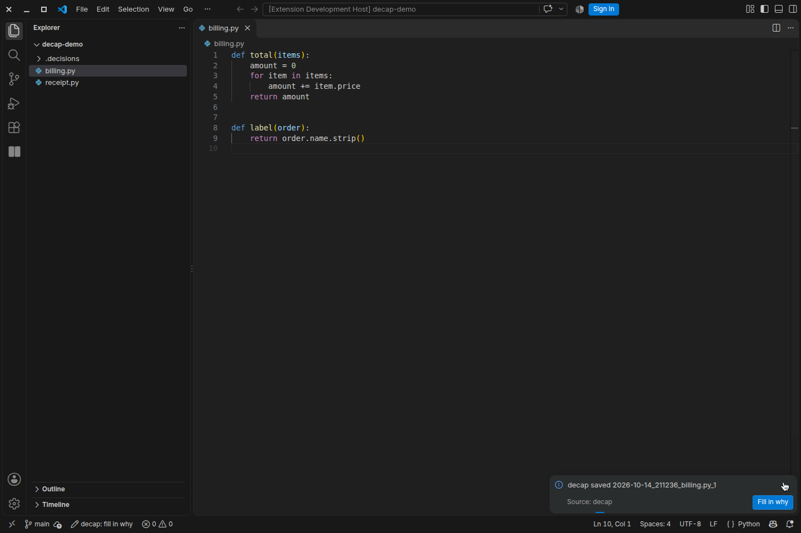
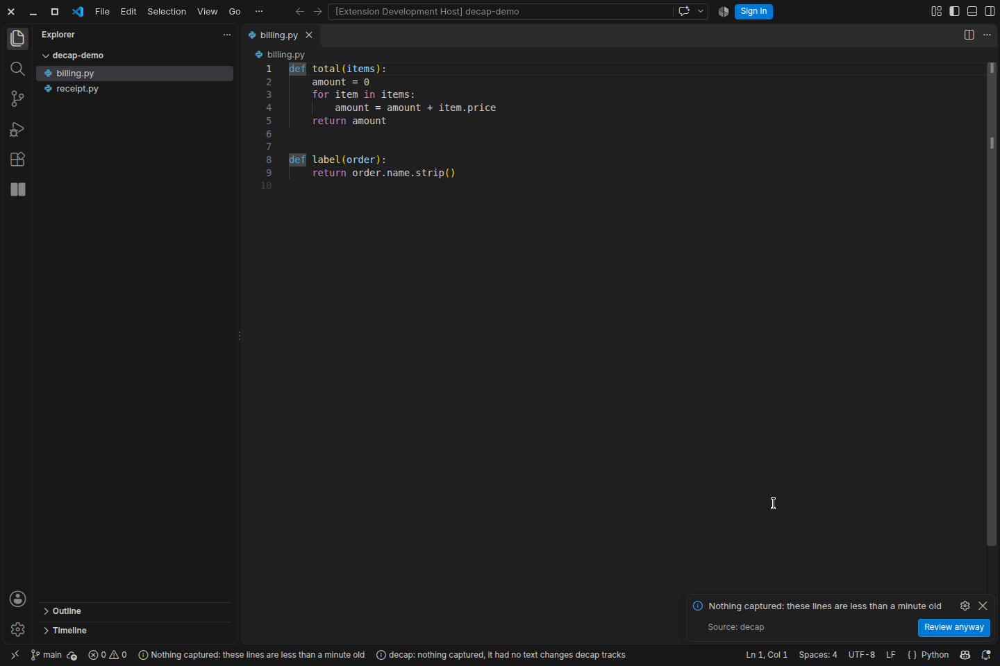
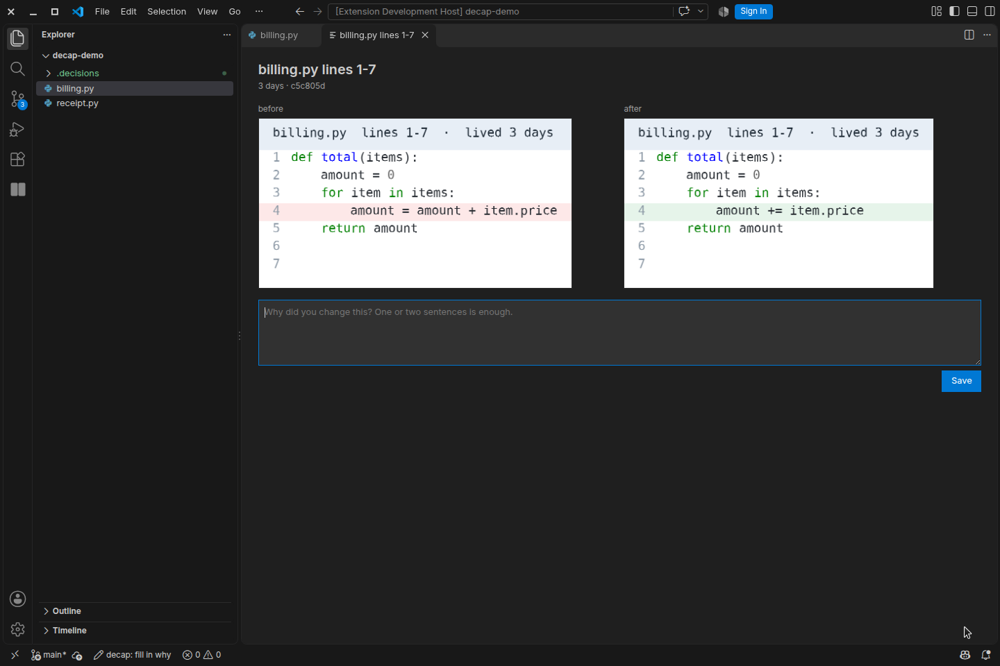
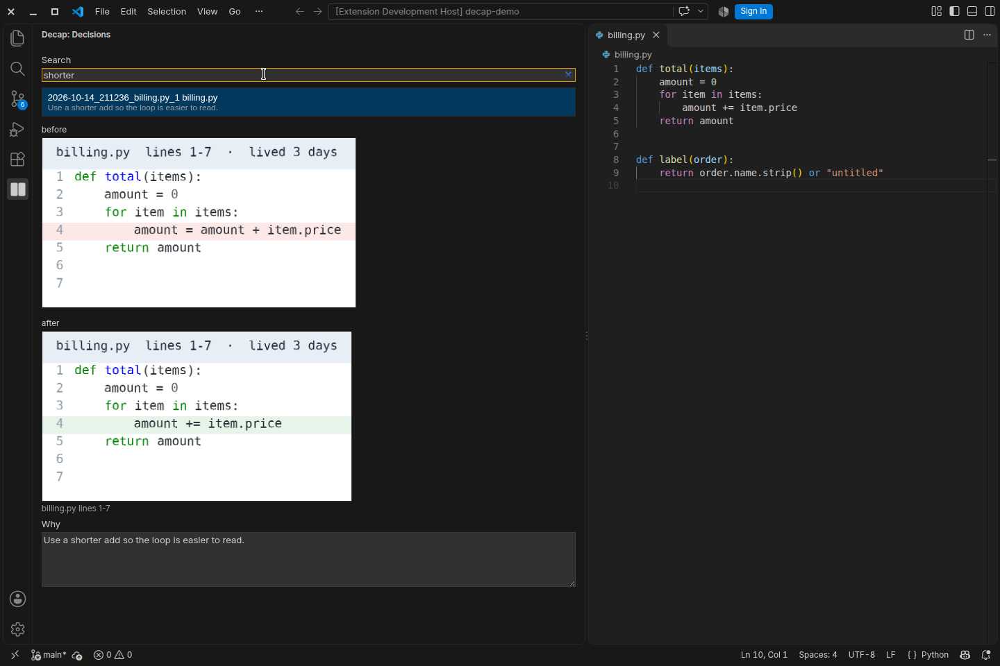

# decap

decap saves a before image and an after image when a commit changes a line that is at least 12 hours old. You write why you made the change. You can search that note later.

## Quick start

Install `quarkos.decap` from Open VSX in Cursor or VS Code. Open a folder that contains a git repository.

## Commit a change

Commit a change to a line that is at least 12 hours old while the window is open. decap saves the before image and the after image. A commit made while the window is closed is saved the next time you open the folder, when the line is at least 12 hours old.

A notice says that decap saved the change. The notice offers **Fill in why**. The status bar shows `decap: fill in why`.

If the line is less than 12 hours old, decap does not save images. The notice offers **Review anyway**.

Run **decap: Review last commit** to save the latest commit at any age.

## Fill in why

**Fill in why** opens a form for the changed file. The form shows the before image and the after image. Write the reason, then choose **Save**.

## Past decisions

Run **decap: Open decisions** to open the list. The newest capture is first. Type in **Search** to keep rows that match the reason, the file name, or the age.

